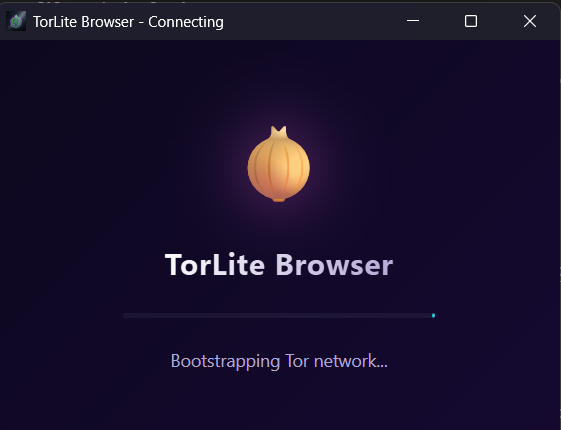
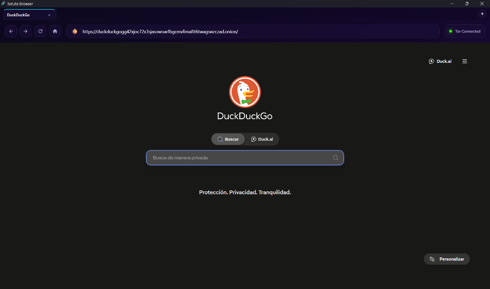

# TorLite Browser

[](https://tauri.app/)
[](https://www.rust-lang.org/)
[](https://www.torproject.org/)
[](LICENSE)

[Español](#español) · [English](#english)

---

## Español

### Índice

- [Descripción](#descripción)
- [Capturas](#capturas)
- [Características](#características)
- [Requisitos](#requisitos)
- [Instalación](#instalación)
- [Compilación para distribución](#compilación-para-distribución)
- [Arquitectura](#arquitectura)
- [Aviso de seguridad](#aviso-de-seguridad)
- [Créditos y marcas](#créditos-y-marcas)
- [Licencia](#licencia)

### Descripción

Navegador web **experimental** con pestañas, ligero, construido con **Tauri v2** y **Rust**. Enruta el tráfico de cada pestaña a través de la **red Tor** usando **Arti**, el cliente Tor oficial escrito en Rust, sin depender del demonio Tor instalado en el sistema.

El enfoque es la **privacidad amnésica**: cada pestaña tiene su propio directorio de datos y este se borra al cerrarla, de modo que no quedan cookies, caché ni historial entre sesiones.

### Capturas

| Interfaz del navegador | Pantalla de arranque de Tor |
| :---: | :---: |
|  |  |

### Características

- **Integración con Tor** mediante Arti, sin instalación externa del demonio.
- **Proxy SOCKS5 local** que enruta el WebView2 a través de Tor.
- **Pestañas** con controles unificados: atrás, adelante, recargar y barra de direcciones.
- **Aislamiento por pestaña**: cada una usa un directorio de datos distinto, sin cookies, caché ni `localStorage` compartidos.
- **Limpieza amnésica**: el perfil de una pestaña se elimina un segundo después de cerrarla y los perfiles huérfanos se purgan al arrancar.
- **Intercepción de ventanas nativas**: los enlaces con `_blank` o «Abrir en ventana nueva» se abren como pestaña, no como ventana del sistema.
- **Indicador onion**: se ilumina en morado al visitar servicios `.onion` y muestra el progreso de arranque de Tor.

### Requisitos

| Requisito | Nota |
|---|---|
| **Rust y Cargo** | Estable o nightly ([rustup](https://www.rust-lang.org/tools/install)) |
| **Node.js y npm** | Para las dependencias del frontend |
| **WebView2** | Preinstalado en Windows 10/11; si falta, instala el runtime |
| **Build Tools de C++** | Visual Studio Build Tools con la carga de trabajo C++ |

El proyecto está orientado a **Windows** por el uso de WebView2; Tauri permite otras plataformas, pero esta configuración no las garantiza.

### Instalación

```bash
git clone https://github.com/alberto2005-coder/TorLite_Browser.git
cd TorLite_Browser
npm install
npm run tauri dev
```

El modo desarrollo recompila al detectar cambios. El primer arranque de Arti puede tardar unos segundos mientras se establece el circuito Tor.

### Compilación para distribución

```bash
npm run tauri build
```

Resultados:

1. **Ejecutable portable**: `src-tauri/target/release/TorLite Browser.exe`.
2. **Instalador MSI**: `src-tauri/target/release/bundle/msi/TorLite Browser_0.1.0_x64_en-US.msi`.

Ambos son autónomos: quien los reciba no necesita Rust, Node.js ni Tor. En Windows 10/11 WebView2 ya viene instalado; en versiones anteriores el MSI lo descarga.

### Arquitectura

- **`src-tauri/src/lib.rs`**: backend Rust con el bucle del proxy SOCKS5, el arranque de Tor mediante `arti-client`, el ciclo de vida de las webviews, el redimensionado y la intercepción de ventanas nuevas.
- **`src/bootstrap.html`**: pantalla animada que muestra el estado de conexión con Tor.
- **`src/index.html`** y **`src/styles.css`**: interfaz glassmorphism, barra de navegación y pestañas.
- **`src/main.js`**: controlador del frontend: estado de pestañas, renderizado, barra de direcciones e IPC con Tauri.
- **`src-tauri/tauri.conf.json`**: ventana, permisos y configuración del empaquetado.

### Aviso de seguridad

> [!WARNING]
> Este navegador es un **experimento**, no una herramienta de anonimato auditada. No lo uses para actividades que dependan de un anonimato fuerte.

- **No hereda las protecciones del Tor Browser**: no incluye *anti-fingerprinting*, aislamiento por sitio de primera parte ni el endurecimiento de `about:config`.
- **WebView2 no es un motor pensado para privacidad**: puede filtrar características del sistema y del propio WebView.
- **El borrado de perfiles reduce rastros en disco**, pero no elimina los que deje el sistema operativo, la red o el propio WebView2 durante la sesión.
- **Sin auditoría independiente**: el código no ha pasado una revisión de seguridad externa.
- **Cumplimiento**: el uso de Tor puede estar restringido en tu país o en tu red; comprueba la normativa aplicable.

### Créditos y marcas

- **Tauri** — licencia dual MIT / Apache-2.0.
- **Arti** — cliente Tor del Tor Project, licencia dual MIT / Apache-2.0.
- **Wry** — licencia dual MIT / Apache-2.0.

*«Tor» y el logotipo «Onion» son marcas registradas de The Tor Project, Inc. Este proyecto es un experimento independiente y no está afiliado ni respaldado por The Tor Project.*

### Licencia

**GNU General Public License v3.0 (GPL-3.0)** — consulta [LICENSE](LICENSE). Las licencias de terceros indicadas arriba se aplican solo a esas dependencias.

---

## English

### Table of contents

- [Overview](#overview)
- [Screenshots](#screenshots)
- [Features](#features)
- [Requirements](#requirements)
- [Installation](#installation)
- [Production build](#production-build)
- [Architecture](#architecture)
- [Security notice](#security-notice)
- [Credits and trademarks](#credits-and-trademarks)
- [License](#license)

### Overview

An **experimental**, lightweight tabbed web browser built with **Tauri v2** and **Rust**. It routes each tab's traffic through the **Tor network** using **Arti**, the official Rust Tor client, without depending on a system-wide Tor daemon.

The focus is **amnesic privacy**: every tab gets its own data directory, which is deleted when the tab closes, so no cookies, cache or history survive between sessions.

### Screenshots

| Browser interface | Tor bootstrap splash |
| :---: | :---: |
|  |  |

### Features

- **Tor integration** through Arti, with no external daemon installation.
- **Local SOCKS5 proxy** routing WebView2 through Tor.
- **Tabs** with unified controls: back, forward, reload and address bar.
- **Per-tab isolation**: each tab uses a separate data directory, with no shared cookies, cache or `localStorage`.
- **Amnesic cleanup**: a tab's profile is removed one second after it closes, and orphan profiles are purged on start-up.
- **Native window interception**: `_blank` links and "Open in new window" become tabs instead of OS windows.
- **Onion indicator**: glows purple on `.onion` services and shows real-time Tor bootstrap progress.

### Requirements

| Requirement | Note |
|---|---|
| **Rust and Cargo** | Stable or nightly ([rustup](https://www.rust-lang.org/tools/install)) |
| **Node.js and npm** | For the frontend dependencies |
| **WebView2** | Preinstalled on Windows 10/11; install the runtime otherwise |
| **C++ Build Tools** | Visual Studio Build Tools with the C++ workload |

The project targets **Windows** because of WebView2; Tauri supports other platforms, but this configuration does not guarantee them.

### Installation

```bash
git clone https://github.com/alberto2005-coder/TorLite_Browser.git
cd TorLite_Browser
npm install
npm run tauri dev
```

Dev mode rebuilds on file changes. The first Arti bootstrap can take a few seconds while the Tor circuit is established.

### Production build

```bash
npm run tauri build
```

Outputs:

1. **Portable executable**: `src-tauri/target/release/TorLite Browser.exe`.
2. **MSI installer**: `src-tauri/target/release/bundle/msi/TorLite Browser_0.1.0_x64_en-US.msi`.

Both are self-contained: recipients need no Rust, Node.js or Tor. Windows 10/11 already ships WebView2; older versions get it downloaded by the MSI.

### Architecture

- **`src-tauri/src/lib.rs`**: Rust backend with the SOCKS5 proxy loop, Tor bootstrap via `arti-client`, webview lifecycle, resizing and new-window interception.
- **`src/bootstrap.html`**: animated screen showing the Tor connection status.
- **`src/index.html`** and **`src/styles.css`**: glassmorphism UI, navigation bar and tabs.
- **`src/main.js`**: frontend controller for tab state, rendering, address bar and Tauri IPC.
- **`src-tauri/tauri.conf.json`**: window, permissions and bundling configuration.

### Security notice

> [!WARNING]
> This browser is an **experiment**, not an audited anonymity tool. Do not rely on it for activities that require strong anonymity.

- **It does not inherit Tor Browser's protections**: no anti-fingerprinting, no first-party isolation, no hardened `about:config`.
- **WebView2 is not a privacy-oriented engine**: it may leak system and WebView characteristics.
- **Profile wiping reduces on-disk traces**, but does not remove what the OS, the network or WebView2 leaves during the session.
- **No independent audit**: the code has not undergone external security review.
- **Compliance**: Tor use may be restricted in your country or network; check the applicable rules.

### Credits and trademarks

- **Tauri** — dual MIT / Apache-2.0 licence.
- **Arti** — Tor Project's Tor client, dual MIT / Apache-2.0 licence.
- **Wry** — dual MIT / Apache-2.0 licence.

*"Tor" and the "Onion" logo are registered trademarks of The Tor Project, Inc. This project is an independent experiment and is not affiliated with or endorsed by The Tor Project.*

### License

**GNU General Public License v3.0 (GPL-3.0)** — see [LICENSE](LICENSE). The third-party licences above apply only to those dependencies.
